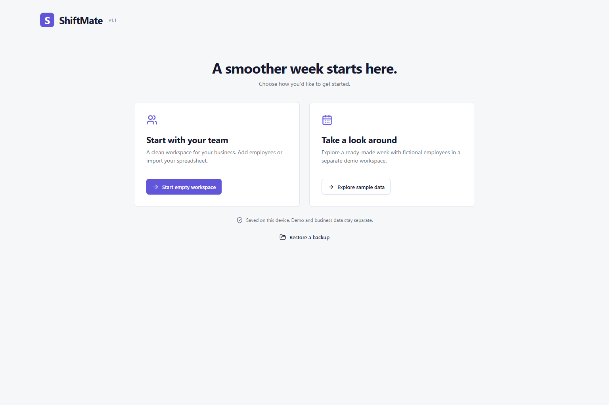
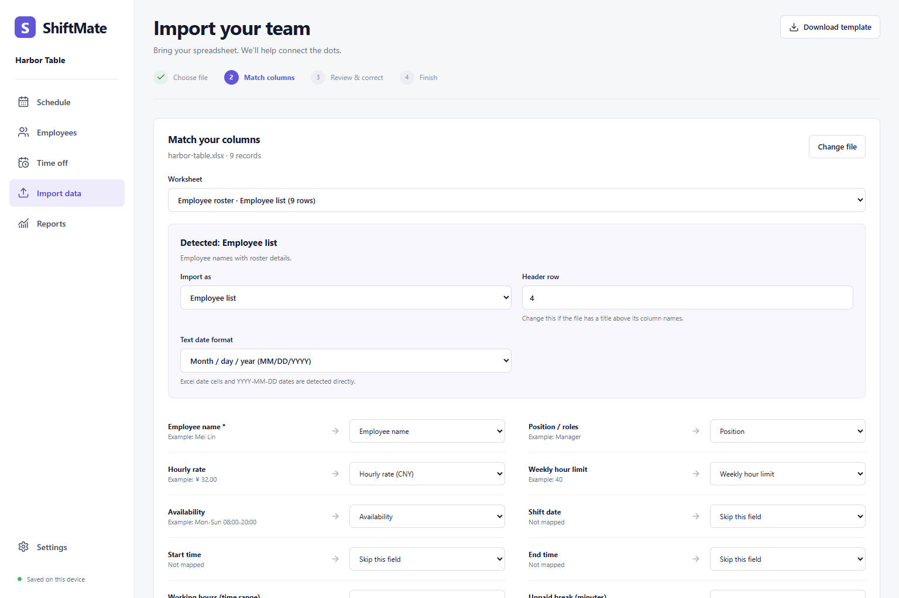
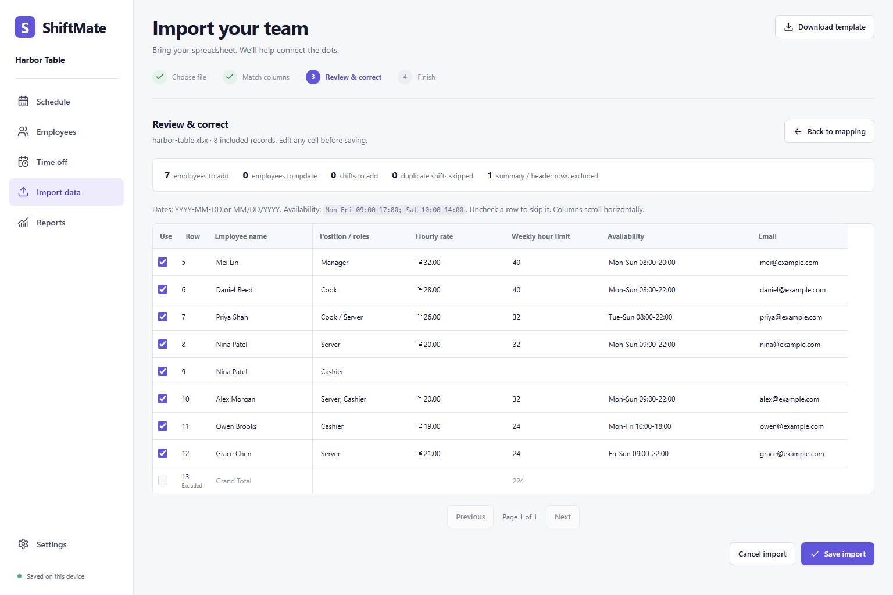
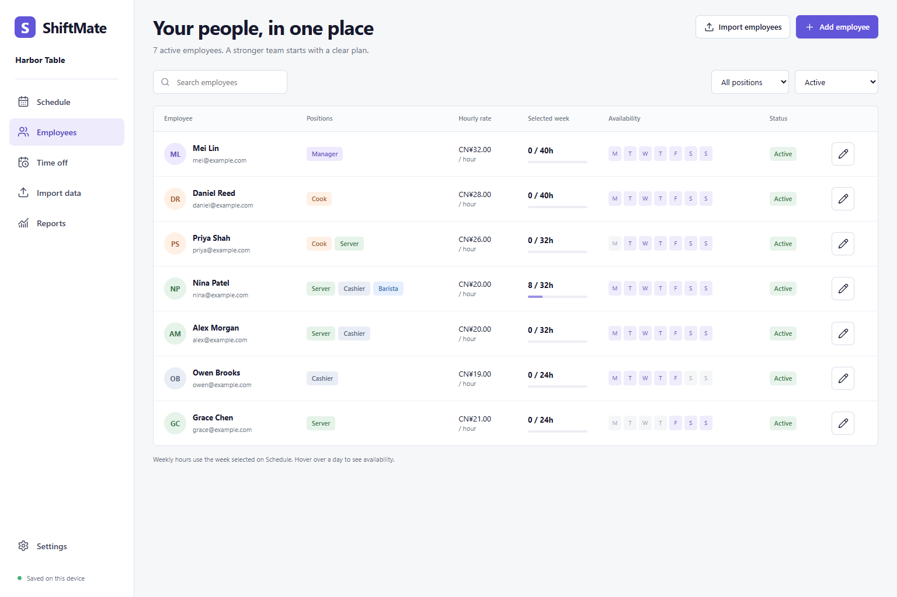
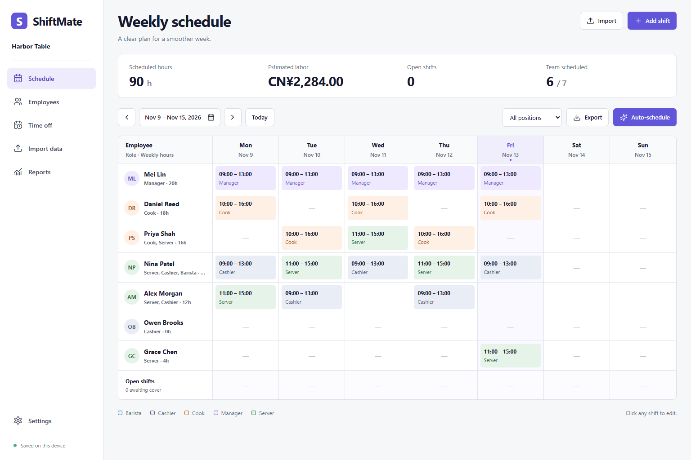
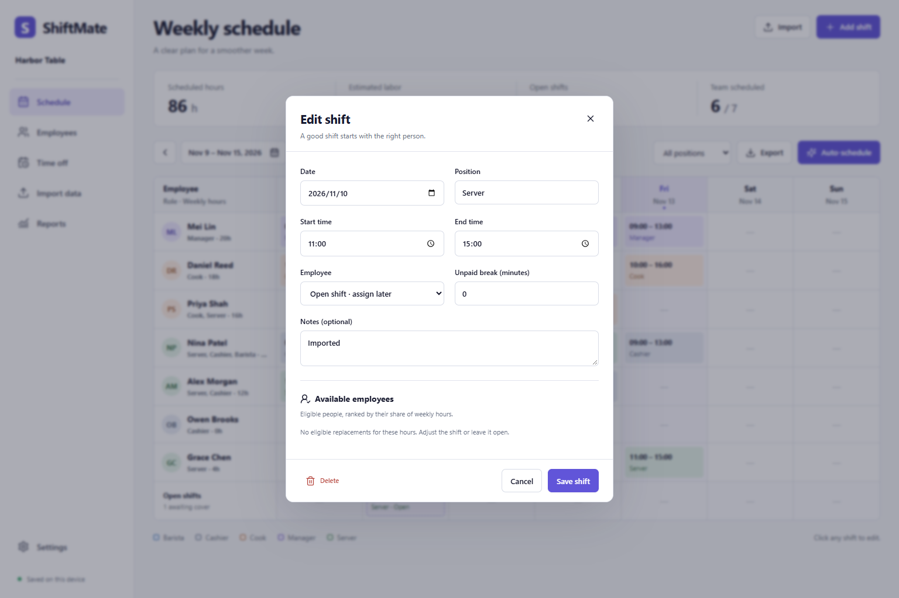
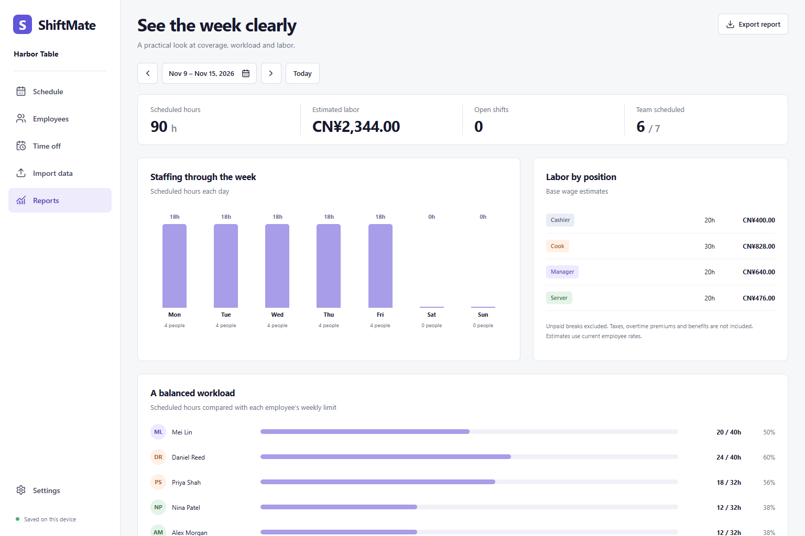
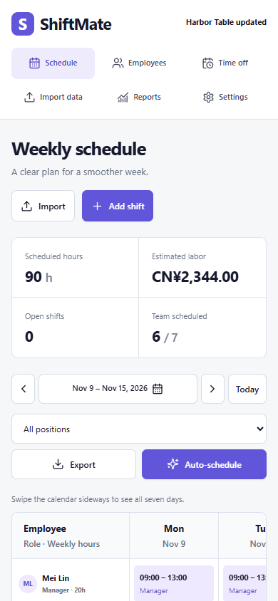
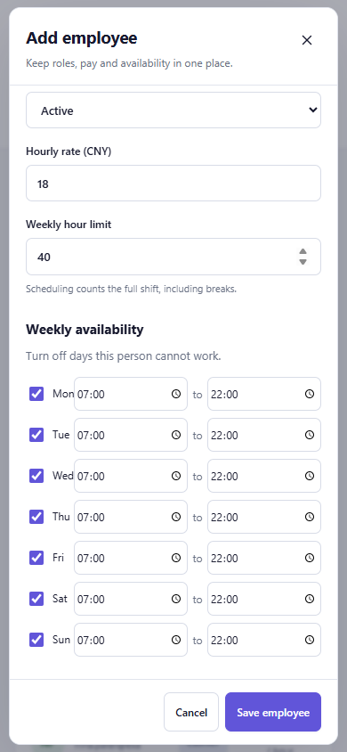
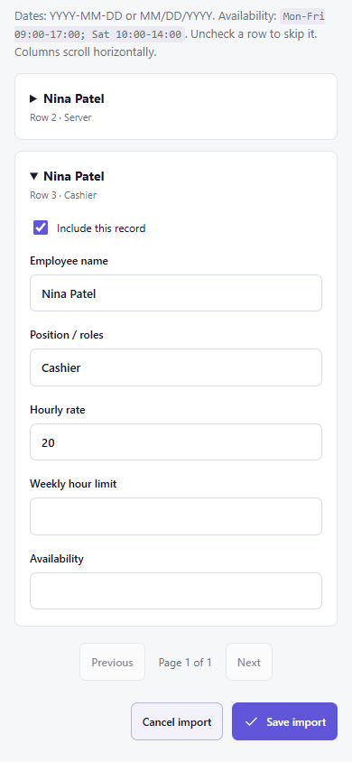

# ShiftMate v1.1

An offline employee scheduler for small businesses. The familiar English interface is retained; v1.1 improves workspace separation, scheduling coverage, spreadsheet recognition, multiple-role imports and mobile use. CNY is now available alongside USD, EUR, GBP, CAD and AUD.

## Open the app

1. Right-click **ShiftMate-v1.1.0.zip → Extract All**, if using the ZIP.
2. Open the extracted **ShiftMate** folder and double-click **ShiftMate.html**.
3. If it opens in an editor, right-click → **Open with → Microsoft Edge** or **Google Chrome**.
4. Choose **Start empty workspace** for your business, or **Explore sample data** for a separate fictional team.

**Success:** the business workspace starts with zero employees and no sample shifts. The demo has a visible **Demo workspace** banner. Later launches reopen your saved workspace.

No installation, terminal, account, server or internet connection is required. Keep the HTML file in a stable location and use the same browser/profile. Double-click **GUIDE.html** to read this illustrated guide in a browser.



## Upgrade from v1.0

1. In the old app, use **Settings → Download backup** before replacing files. Keep the backup and the v1.0 ZIP.
2. Put the new **ShiftMate.html** at the same path and open it in the same browser/profile. If the app cannot find the old data, use **Restore a backup** instead.
3. Choose **Review v1.0 data**. Check the list and select only your real employees. Known, unchanged Maple & Main sample records are excluded automatically. Renamed or modified sample records still need your review.
4. Choose **Save selected team**. Recreate your staffing requirements in Settings.

**Success:** selected employees, their assigned shifts and leave are copied to the business workspace. The original v1.0 storage remains untouched. Old open shifts and staffing requirements are deliberately left out because v1.0 did not identify their origin. This review remains accessible from Settings if you initially choose an empty workspace.

Restoring or migrating replaces any existing v1.1 business workspace after an explicit prompt; download its backup first.

## Keep business and demo separate

**Settings → Explore sample data** opens the demo without replacing your business. **Use my business workspace** returns to your real records. Each workspace saves independently. Importing and adding/editing employees are routed to the business workspace; demo Excel exports and demo backups cannot be restored into it.

The included spreadsheet fixtures are fictional test inputs. Use a separate browser profile for the walkthrough below, so those names never enter your live business workspace. Arbitrary spreadsheets cannot be identified as fictional automatically: always review the detected records before saving.

## Import and review your spreadsheet

1. Open **Import data → Choose file**, or drop a CSV, TSV, XLSX or XLS file onto the page. Maximum: 10 MB, 2,000 records and 100 columns per worksheet.
2. Check **Worksheet**, **Detected**, **Import as** and **Header row**. Titles above the column names are recognized. A workbook beginning with a summary sheet automatically selects the first recognized roster or shift sheet.
3. Verify each column mapping. Use **Skip this field** where appropriate. Set **Text date format** to month/day/year or day/month/year for slash-separated dates.
4. Choose **Review records**. Correct values, inspect changes to existing employees, and review any missing-value defaults. On a phone, expand a record to edit its labelled fields.
5. Correct every error or uncheck the affected record. Choose **Save import**.

**Success:** the confirmation lists employees added/updated and shifts added. Nothing is saved until the whole preview is valid. The source spreadsheet stays unchanged.



The importer distinguishes employee lists, dated shift records, summary tables and calendar grids. Summary tables and calendar grids are blocked by default; choose a roster or convert to one row per shift. Total, subtotal and repeated header rows are visibly excluded. Numeric “Hours” is not assumed to be a time range or weekly limit, and “Department” is not assumed to be a qualification.



| Field | Example / behavior |
| --- | --- |
| Employee name | `Nina Patel`; matches ignore case and repeated whitespace |
| Position / roles | `Server, Cashier`; comma, semicolon, slash or pipe separators |
| Hourly rate | `20`, `26.50`, `¥26.50` or `CNY 26.50`; use a decimal point |
| Weekly hour limit | `32`; use an explicit limit column, not a report total |
| Availability | `Mon-Fri 09:00-17:00; Sat 10:00-14:00`, or `Unavailable` |
| Shift date | `2026-11-09`; slash dates follow your selected format |
| Start / end time | `09:00`, `5 PM`, or a formatted Excel time cell |
| Working hours | `09:00-17:00`; a time range, not a total such as `8` |

Native Excel dates, including the 1904 date system, are recognized. UTF-8/UTF-16 CSV and Excel `sep=` delimiter lines are supported. Unsupported text encodings produce an error; resave as CSV UTF-8.

Repeated records **combine positions** with the employee’s existing positions. Each shift keeps its own specific role. If a shift row lists multiple roles, you must specify the role for that shift. Different pay, weekly-limit, email or overlapping availability values for the same employee are flagged for correction instead of silently using the last row. Exact repeated shifts are skipped. Existing unmapped fields are retained.

For an employee list, start/end or working-hours fields describe recurring availability. Separate weekday availability records can combine, but different windows for the same weekday require correction. Missing information for a new employee defaults to **Team member**, **0 hourly rate**, **40h weekly limit**, and **07:00–22:00 every day**; the preview explicitly lists those defaults. Names must identify people uniquely; distinguish two employees with the same name before importing.

## Manage employees

1. Choose **Employees → Add employee** or the pencil beside an existing employee.
2. Enter the name, positions, hourly rate and weekly limit. Separate multiple positions with commas.
3. Set each weekday’s availability; uncheck unavailable days.
4. Choose **Save employee**.

**Success:** the employee appears with all positions and their weekly availability. Changes that would invalidate saved shifts are blocked; edit or unassign those shifts first. Inactive employees cannot receive new assignments.



## Generate a weekly schedule

1. In **Settings**, set your business name, currency and minimum rest, then choose **Save settings**.
2. Under **Staffing requirements**, add the position, hours, weekdays, number of people and unpaid break for each required shift.
3. On **Schedule**, choose the week. Add individual shifts manually if needed.
4. Choose **Auto-schedule**, review the covered/open shifts and any reassignment count, then choose **Apply schedule**. You can cancel without changing saved data.

**Success:** covered shifts appear under employees; unmet demand remains in **Open shifts**. Generating again does not duplicate matching requirements. Manual and imported assignments remain fixed unless you select **Also reconsider this week’s manual assignments**. Earlier automatic assignments can move to improve coverage.



The v1.1 scheduler tries several initial arrangements and searches alternative combinations, including leaving a less useful assignment open when that allows more shifts to be filled. It checks qualifications, active status, availability, approved leave, overlap, minimum rest and weekly limits. Workload ratios guide equivalent choices; coverage comes first.

Search runs in a background worker. Backtracking is limited to approximately 1.8 seconds or 180,000 search nodes; preparation time is additional. If the limit is reached, the preview says so and returns the best valid arrangement found. A limited search is not a guarantee of maximum coverage. Fixed manual assignments can also prevent full coverage; reconsider them only when you are willing to change them.

## Handle leave and find cover

1. Choose **Time off → New request**. Select an employee and an inclusive date range, then save.
2. Choose **Approve → Approve time off**, or decline the request.
3. Return to the affected week on **Schedule**. Approved leave preserves the shift but clears its assignment.
4. Open that shift and select from **Available employees**, then save. Alternatively, run **Auto-schedule** to try rearrangements across the week.

**Success:** the approved absence remains visible and no shift is assigned to that person during leave. Suggested replacements satisfy the scheduling rules. If no direct replacement fits, moving other automatic assignments may still provide cover. **Report absence** in a shift dialog pre-fills a leave request.



## Reports, currency and exports

1. Open **Reports** to see staffing, workload and estimated base labor for the selected week.
2. Choose **Export report**, or **Schedule → Export**.
3. Select **Excel workbook** or **PDF schedule**. Open the downloaded file from the browser’s Downloads folder.

**Success:** Excel has **Weekly calendar**, **Shifts**, **Employees** and **Summary** tabs. The PDF contains the selected week, including open shifts and time off. Exports cover the whole week regardless of the calendar’s position filter.



Set **Settings → Currency → CNY → Save settings** for yuan amounts throughout the UI and exports. Changing currency changes the display unit; it does not convert existing rates. Enter rates in the selected currency.

Labor estimates use current hourly rates and exclude unpaid breaks. Weekly limits and workload count the full shift duration. Taxes, benefits, overtime premiums and historical rate snapshots are not included. PDF text is rendered as an image to preserve international names, so it is not searchable/selectable. Use JSON backups to preserve the entire workspace; spreadsheet exports are reports, not complete backups.

## Mobile use

All six pages remain visible in the mobile navigation. Swipe the calendar horizontally to see the full week; the employee column stays in place. Employee dialogs scroll their fields while keeping **Save employee** visible. Import review uses expandable records instead of a wide editing table.

  

These layouts were checked at 390px and 320px in desktop browser emulation. Native mobile file-opening behavior, iOS/Safari and Android browsers were not tested.

## Try the realistic restaurant workflow

Use a separate browser profile and choose **Start empty workspace**. All fixture people and contact details are fictional. The supplied shift dates are in the week beginning **2026-11-09**; select that week when trying the released files.

1. Set the business name to **Harbor Table**, currency to **CNY**, and keep the 10-hour rest rule.
2. Import **samples/harbor-table.xlsx → Employee roster**. Header row **4** is detected. Review and save.
   **Success:** seven employees; Nina Patel has both Server and Cashier roles; Grand Total is excluded.
3. Import the same workbook’s **Shift records** sheet. Header row **3** is detected.
   **Success:** Nina has a Monday Cashier shift and Tuesday Server shift. Her roles remain combined.
4. Import **samples/role-update.csv**.
   **Success:** Nina gains Barista while keeping Server and Cashier.
5. Import **samples/conflicting-pay.csv**. In Review, change row 3’s hourly rate from **25** to **20**, then save.
   **Success:** the inconsistent-pay error disappears; Nina remains one employee.
6. Add the following requirements in Settings, each for **Mon–Fri**, **one person**, **zero break minutes**.

| Position | Start | End |
| --- | --- | --- |
| Manager | 09:00 | 13:00 |
| Cook | 10:00 | 16:00 |
| Server | 11:00 | 15:00 |
| Cashier | 09:00 | 13:00 |

7. Select the fixture week and run Auto-schedule.
   **Success in the verified fixture:** 20 shifts, 90 hours, zero open shifts, CNY 2,284 base labor.
8. Request and approve Nina’s Tuesday leave. Open the vacant shift to inspect replacements, then run Auto-schedule again.
   **Success in the verified fixture:** 20 covered shifts, 90 hours, no conflicts, CNY 2,344 base labor; Nina is not assigned Tuesday.
9. Export Excel and PDF. Download a JSON backup, close/reopen the browser, and confirm the same workspace returns.

Equivalent valid arrangements can have different costs. The algorithm prioritizes coverage and workload, not minimum wage cost.

Other included files: **harbor-table.xls** tests legacy Excel; **harbor-team.csv**, **harbor-shifts.csv** and **harbor-summary.csv** separate the three table types. Earlier simple fixtures remain in **samples/**. **sample-week.xlsx** is a labelled demo export for viewing; importing it into business data is blocked.

## Saving, recovery and data risks

Changes save automatically in this browser on this device. Use **Settings → Download backup** regularly. Restore via the welcome screen or **Settings → Restore backup**; inspect the replacement prompt before confirming. **Clear workspace** removes only the current workspace after confirmation.

**Success:** reopening the same file in the same browser/profile restores your work. The tests also verify a complete browser-process restart. Failed saves show a warning; corrupt data is not silently overwritten. If another tab changes the workspace, reload before editing.

Moving/renaming the file, clearing browser data, deleting the browser profile or using private browsing can make saved records unavailable. The app does not encrypt browser storage. Backups and exported files contain employee information; keep them somewhere appropriate. No external accounts, uploads or network requests are used by the app.

For developers, business storage is `shiftmate.business.v1.1`, demo storage is `shiftmate.demo.v1.1`, and the active mode is `shiftmate.active.v1.1`. The legacy `shiftmate.workspace.v1` key is preserved during migration.

## Scope and practical limits

- One manager’s local workspace; no accounts, synchronization, notifications or payroll integration.
- Monday–Sunday weeks, same-day shifts, one availability window per weekday and whole-day leave. Overnight work is not modelled as a continuous shift; separate dated entries still obey the rest rule.
- Wall-clock scheduling; daylight-saving transitions are not payroll-adjusted.
- Maximum 500 employees, 50,000 shifts, 10,000 leave records and 100 requirements, subject to browser storage and performance. These are validation limits, not a claim that maximum-size schedules finish quickly.
- Review local staffing rules yourself; the app does not encode jurisdiction-specific labor requirements.

## Verification and development

The ready-to-open HTML needs no developer tools. The source uses React, local scheduling/import modules and a worker bundled by esbuild. Existing dependency versions are retained; SheetJS and jsPDF are bundled locally with license notices in **THIRD-PARTY-NOTICES.txt**.

Verified for v1.1:

- **50 automated rule, import, storage and export tests**, including 60 small scheduling cases compared with exhaustive enumeration.
- Complete offline file-URL workflows in installed **Chrome and Edge on Windows**, with zero HTTP requests and browser errors.
- CSV, XLSX and XLS imports; summary exclusion; role merge and correction; CNY; generation; leave and cover; Excel/PDF downloads; backups; migration; stale-tab protection; browser restart.
- Desktop widths 1536/1280 and mobile widths 390/320; real screenshots in **docs/**.
- Exported XLSX independently opened with openpyxl; its 20 rows, 90 hours, currency and cost totals checked. The PDF was independently rendered and visually inspected.

See **docs/QA.md** for the release checks. Screenshots are captured from the working application with fictional fixtures, not mockups. Dates and totals in them are from the verified week.

Optional developer commands below install dependencies and write build/sample/test files. They do not access external accounts. `npm ci` downloads third-party packages and needs network access; runtime use does not.

```powershell
cd ShiftMate
npm ci
npm run build
npm test
npm run test:ui
npm run test:persistence
npm run samples
npm run package
```

**Success:** the build prints the standalone HTML path, tests print their passing results, and packaging creates **ShiftMate-v1.1.0.zip** alongside the folder. Generating fixtures uses the current week, so select their new dates if regenerating them.

Browser tests use installed Chrome and isolated profiles with networking disabled. Set `$env:BROWSER_CHANNEL='msedge'` for Edge. Set `SHIFTMATE_QA_DIR` for screenshot/download output and `SHIFTMATE_CAPTURE_DOCS=1` to refresh the documentation screenshots. They may require permission to create temporary browser profiles and downloads. Packaging includes source, fixtures and documentation, excluding node_modules.
